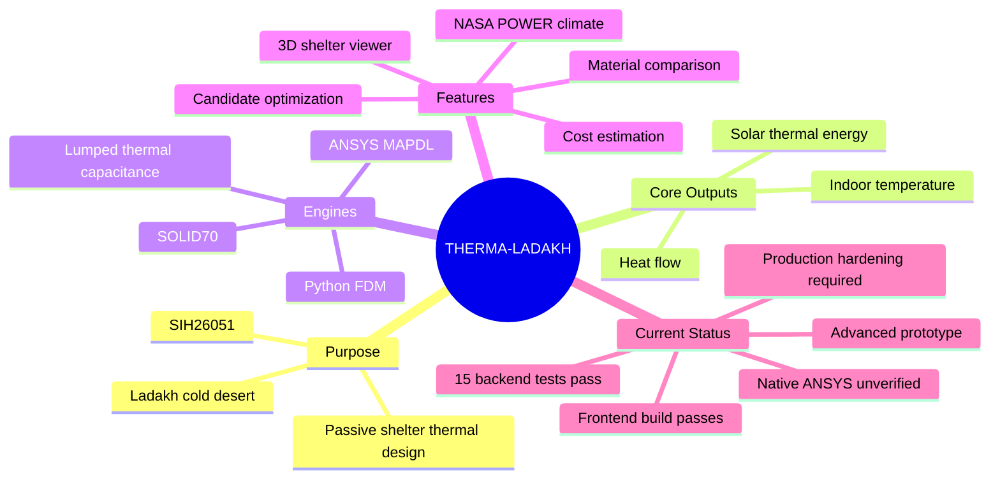
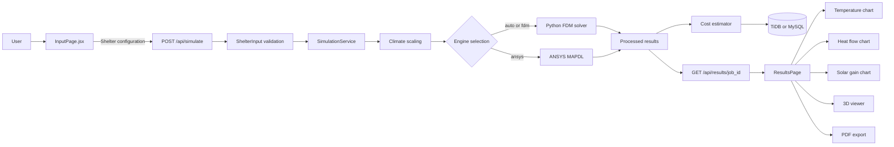
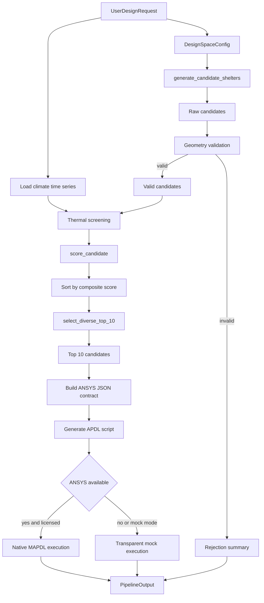
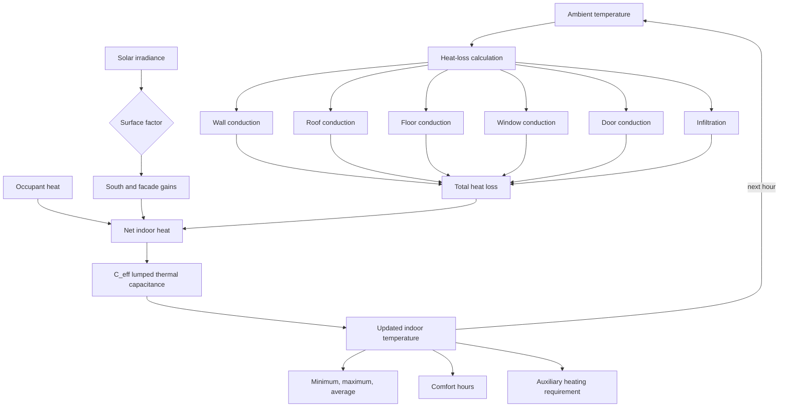
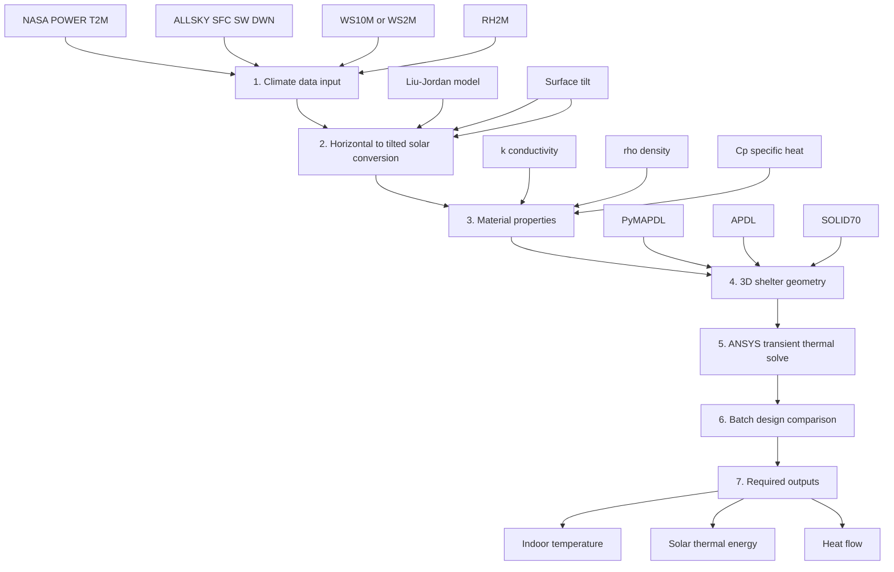
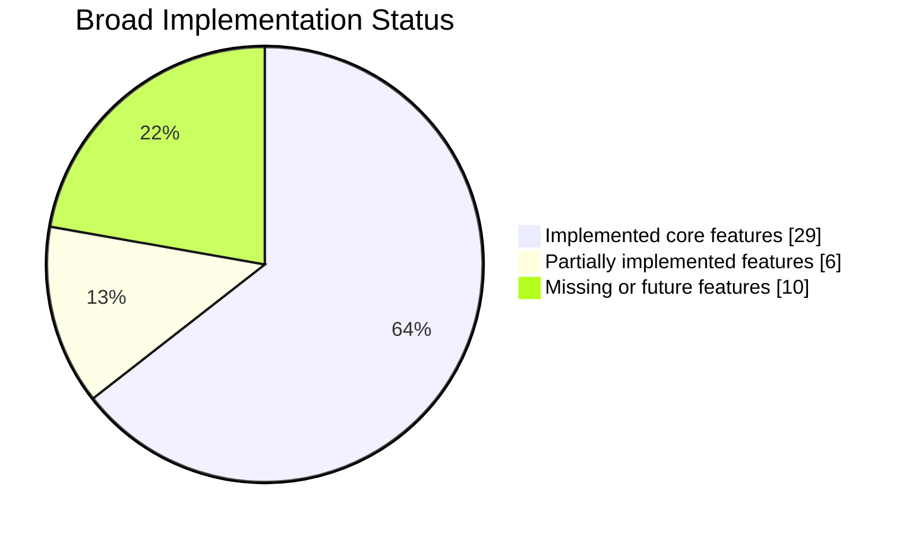
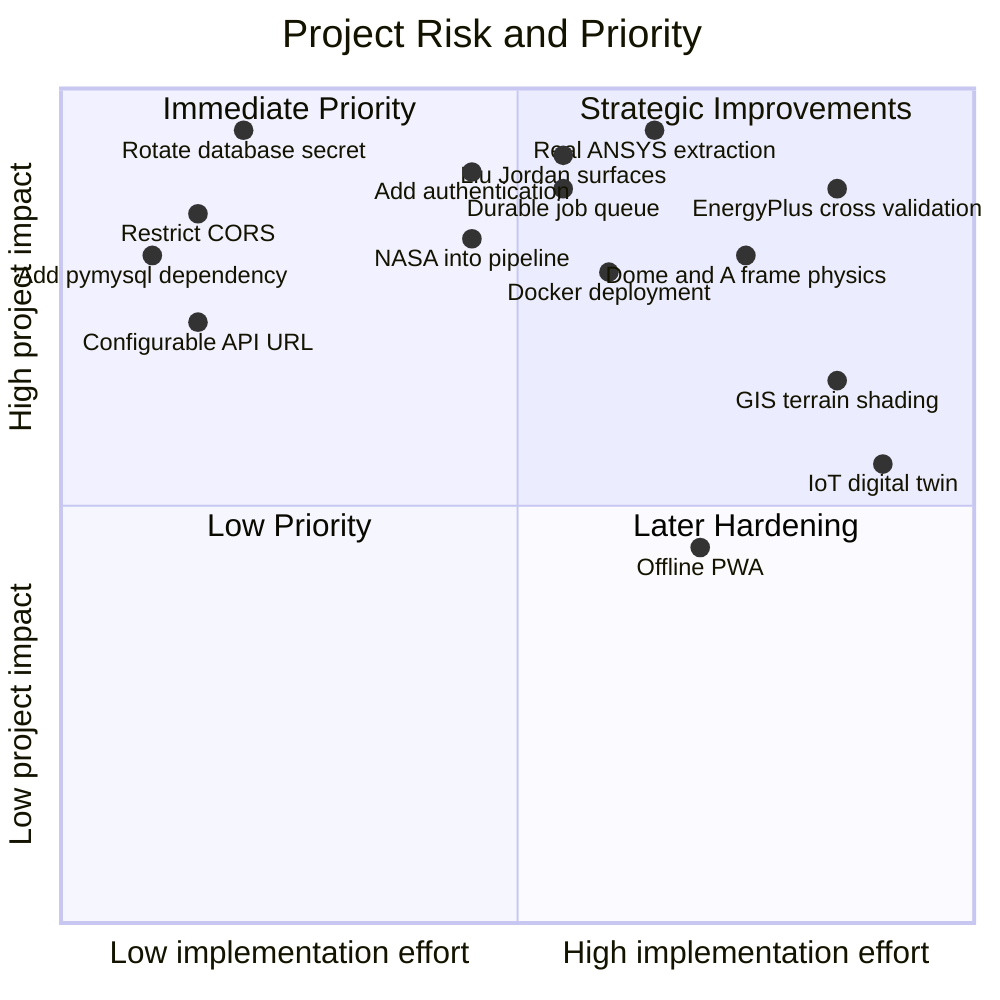
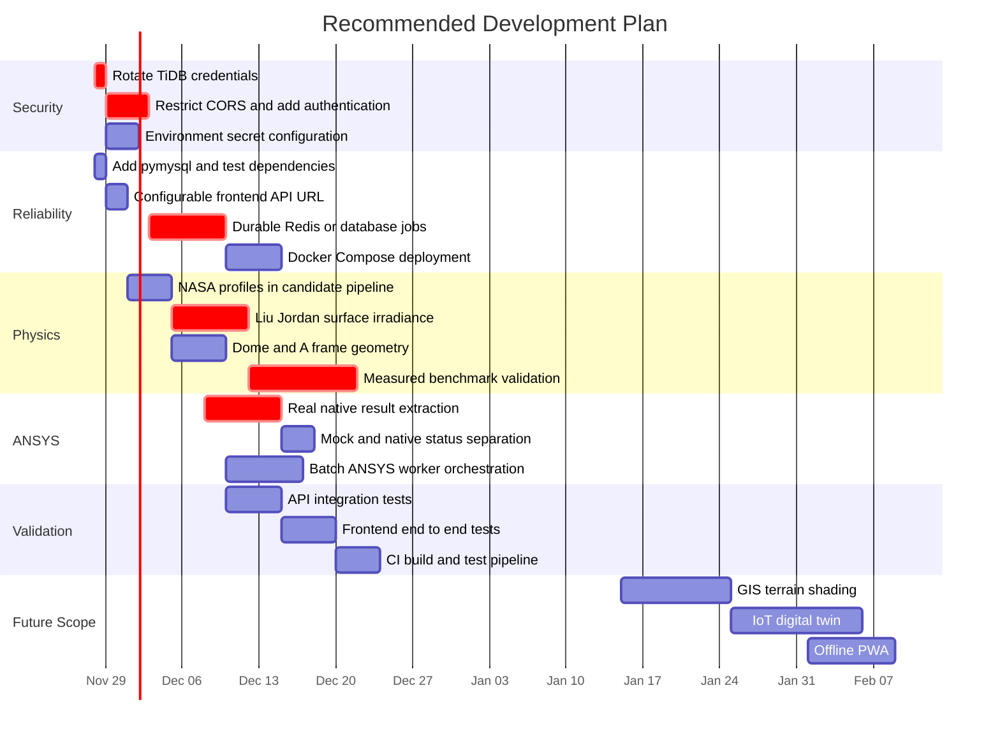
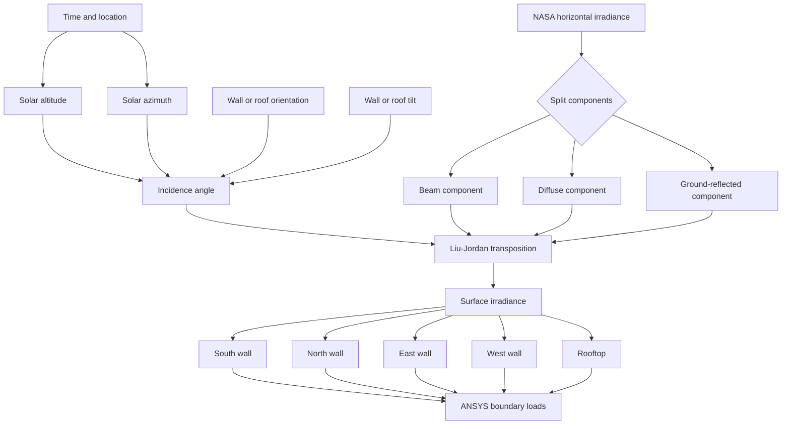

# SIH Thermal - Visual Project Guide

## 1. Project Overview



## 2. Folder and Component Architecture

```mermaid
flowchart TD
  A[SIH_Thermal root] --> B[backend]
  A --> C[frontend]
  A --> D[simulation]
  A --> E[Documentation]
  A --> F[ANSYS scripts]

  B --> B1[app/main.py]
  B --> B2[routers]
  B --> B3[services]
  B --> B4[pipeline]
  B --> B5[db/database.py]
  B --> B6[tests]
  B --> B7[data]

  B2 --> B21[simulation.py]
  B2 --> B22[materials.py]
  B2 --> B23[pipeline_router.py]

  B3 --> B31[simulation_service.py]
  B3 --> B32[fallback_engine.py]
  B3 --> B33[ansys_engine.py]
  B3 --> B34[nasa_climate.py]
  B3 --> B35[optimizer.py]
  B3 --> B36[cost_estimator.py]

  B4 --> B41[pipeline_orchestrator.py]
  B4 --> B42[candidate_generator.py]
  B4 --> B43[geometry_validator.py]
  B4 --> B44[thermal_screening.py]
  B4 --> B45[ranking_engine.py]
  B4 --> B46[diversity_selector.py]
  B4 --> B47[ansys_adapter.py]

  C --> C1[src/main.jsx]
  C --> C2[src/App.jsx]
  C --> C3[pages]
  C --> C4[components]
  C --> C5[api/simulationApi.js]

  C3 --> C31[InputPage.jsx]
  C3 --> C32[ResultsPage.jsx]

  C4 --> C41[3D Viewer]
  C4 --> C42[Temperature Chart]
  C4 --> C43[Heat Flow Chart]
  C4 --> C44[Solar Gain Chart]
  C4 --> C45[Comparison Table]

  D --> D1[generated job directories]

  E --> E1[SIH26051 research]
  E --> E2[project report]
  E --> E3[RESOURCES]

  F --> F1[direct_build.apdl]
  F --> F2[OPEN_IN_ANSYS.bat]
```



## 3. Legacy Simulation Data Flow



## 4. Candidate Pipeline Data Flow



## 5. Thermal Model Components



## 6. SIH26051 Required Build Pipeline



## 7. Implemented and Missing Feature Split



## 8. Priority Risk Matrix



## 9. Release Roadmap



## 10. API Map

```mermaid
flowchart LR
  C[Frontend] --> H[/health]
  C --> M1[/api/materials]
  C --> M2[/api/climate-profiles]
  C --> M3[/api/climate/live]

  C --> S1[POST /api/simulate]
  S1 --> S2[GET /api/results/job_id]

  C --> CP1[POST /api/compare]
  CP1 --> CP2[GET /api/compare/job_id]

  C --> O[POST /api/optimize]

  C --> P1[POST /api/pipeline/generate-and-screen]
  C --> P2[GET /api/pipeline/materials]
  C --> P3[POST /api/pipeline/validate-geometry]

  C --> DB1[/api/db-status]
  C --> DB2[/api/history]

  S1 --> SV[(SimulationService)]
  CP1 --> SV
  O --> SV
  P1 --> OR[Pipeline Orchestrator]

  SV --> SOL{FDM or ANSYS}
  OR --> CAN[Candidate Pipeline]

  SOL --> TD[(TiDB MySQL)]
  CAN --> JD[(ANSYS job directory)]
```

## 11. Solar Geometry Pipeline


